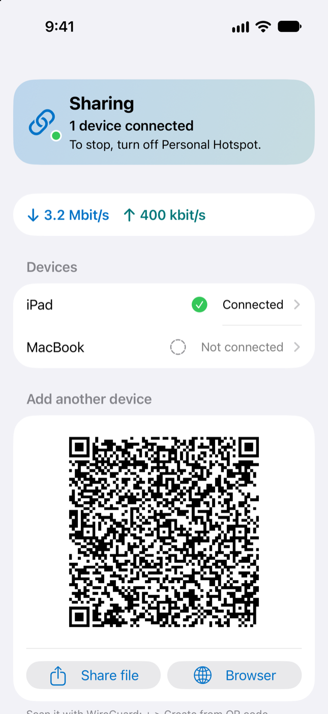
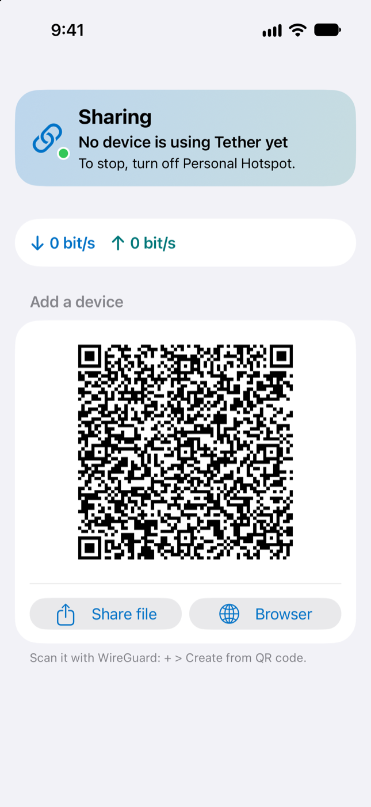

# Tether

Share your iPhone's internet with your iPad, Mac or travel router, even when your cellular plan blocks or slows down Personal Hotspot.

**Each device needs a WireGuard client.** The free WireGuard app works on an iPad, iPhone or Mac, and most travel routers (GL.iNet, UniFi Travel Router) have one built in. A device without WireGuard can still join the hotspot, but its traffic goes straight out as hotspot traffic and Tether doesn't help it.


 

## Why this works

Carriers can tell when traffic comes from a device that's connected to your hotspot, and some plans block it or slow it to a crawl. Traffic that comes from the phone itself is fine.

Tether is a small app that runs on your iPhone. Your iPad, Mac or travel router still joins the hotspot, but instead of sending its traffic straight out, its WireGuard client hands it to Tether. Tether makes the connections itself, so they leave from the iPhone like its own traffic.

```
iPad, Mac or router  ──hotspot──▶  Tether on iPhone  ──cellular──▶  internet
(WireGuard client)
```

Under the hood Tether runs a WireGuard server on UDP port 51820, on the hotspot address `172.20.10.1`. Each device connects with its WireGuard client, and everything goes through, calls and games included. WireGuard's own code decrypts the traffic and a small TCP/IP stack inside Tether ([gVisor](https://gvisor.dev)) makes each connection again from the iPhone. UDP behaves like a full-cone NAT, so calls and games can connect directly. No VPN entitlement or network extension is needed on the iPhone.

## Install Tether on your iPhone

You need an iPhone with Personal Hotspot. Install a ready-made build with a signing app, or build Tether yourself on a Mac.

### With SideStore, AltStore or your own certificate

Each [release](https://github.com/viktor-svirsky/tether/releases) has an unsigned `Tether.ipa`. Your signing app signs it for your iPhone.

- **SideStore or AltStore:** add this source once, then install Tether from it and get updates there:

  ```
  https://github.com/viktor-svirsky/tether/releases/latest/download/source.json
  ```

  Or download `Tether.ipa` from the latest release and open it in the app.
- **Feather, a paid certificate, or anything else that signs an `.ipa`:** download `Tether.ipa` from the latest release and sign it the way you sign other apps.

A signing app usually changes the bundle ID, so a Tether installed this way is a separate app from one you built with Xcode, with its own keys. Add your devices to it again.

### Build it yourself

You need a Mac with Xcode. A free Apple ID is enough.

1. Install [XcodeGen](https://github.com/yonaskolb/XcodeGen) and Go (`brew install xcodegen go`). `xcodegen generate` builds the WireGuard part with Go first, see `scripts/build-wireguard.sh`.
2. Open `project.yml` and set `DEVELOPMENT_TEAM` to your own team ID, and `APP_BUNDLE_ID` to something unique like `com.yourname.tether`. You'll find your team ID in Xcode under Settings > Accounts.
3. Build and install:

   ```sh
   xcodegen generate
   xcodebuild build -project Tether.xcodeproj -scheme Tether \
     -destination "id=<your-iphone-udid>" -derivedDataPath .build-dd -allowProvisioningUpdates
   xcrun devicectl device install app --device <your-iphone-udid> \
     .build-dd/Build/Products/Debug-iphoneos/Tether.app
   ```

   `xcrun devicectl list devices` shows your iPhone's UDID.

   If Tether is already on the iPhone, build it with the same bundle ID, or a second Tether installs next to it with new keys and every device has to be added again. `xcrun devicectl device info apps --device <your-iphone-udid>` shows the installed one, and `APP_BUNDLE_ID=<that id>` at the end of the `xcodebuild` line uses it.
4. The first time, iOS won't open the app until you trust your developer certificate: Settings > General > VPN & Device Management > your Apple ID > Trust.
5. Open Tether. It waits for Personal Hotspot and starts by itself when the hotspot is on. You can leave it in the background.

## Connect a device with WireGuard

This works for an iPad, an iPhone, a Mac or a travel router. Everything goes through, calls and games too, and nothing changes on other Wi-Fi.

Tether's main screen always shows a QR code for the next device, with the steps under it. There is no button to press. Tether has already made a key for that code. The first time a device connects with it, the device shows up in the Devices list by itself, as Device, Device 2 and so on, and the code changes to a new one for the next device. Tap a device to see if it is connected, remove it, or tap its name at the top to rename it.

- **iPad or iPhone:** install the free [WireGuard](https://apps.apple.com/app/id1441195209) app, then + > Create from QR code and scan the code on Tether's screen. Edit the tunnel and turn On-Demand on for Wi-Fi, only for your iPhone's hotspot name, then join the hotspot. The tunnel turns itself on at the hotspot and off everywhere else.
- **Mac:** the same, but use "Share as a file, for a Mac or a router" under the code (AirDrop works) and Import Tunnel(s) from File, since a Mac can't scan the iPhone's screen.
- **Travel router** (a UniFi Travel Router, a GL.iNet): add a WireGuard client in the router's VPN settings from the shared file, connect the router to the iPhone by USB or the hotspot, and turn its VPN on. Some routers send their clients' traffic from the clients' own addresses instead of their tunnel address. Tether notices that by itself and lets the router's clients through, and its traffic covers every device behind it. On other networks, turn the router's VPN off.

Each device has its own key. Removing a device in Tether locks it out without touching the others.

## Start it from Shortcuts

Once no device has been on the hotspot for 10 minutes, iOS suspends Tether, and it has to be opened again before the hotspot comes back. Shortcuts can do that for you. Tether adds two actions to the Shortcuts app, with nothing to set up:

- **Start Tether** wakes Tether in the background, the same as opening it, but it stays off the screen. It shares as soon as a device joins Personal Hotspot in the next 10 minutes. (iOS only makes the hotspot's network while a device is on it, so that's when Tether can see it.)
- **Is Tether Sharing?** says whether Tether is sharing and how many devices are connected. It gives true or false, for an If.

You can also say "Start Tether" to Siri, find it in Spotlight, or put it on the Action button.

iOS has no automation for "Personal Hotspot turned on", so let one shortcut turn on both:

1. In Shortcuts, make a new shortcut named **Hotspot** with two actions: **Set Personal Hotspot** set to On, then **Start Tether**.
2. Run it instead of turning on the hotspot in Settings: from the Action button, a widget, or Siri ("Hotspot").
3. To have it run by itself, add an automation in Shortcuts > Automation that runs Hotspot and is set to Run Immediately. For example, when your car's Bluetooth connects, when you arrive somewhere you share from, or at a time of day.

## Good to know

- **It stops opening after 7 days** when signed with a free Apple ID. Tether says on its main screen when it has three days or less left. Refresh it in SideStore or AltStore, or build and install it again (step 3 above), before then. A paid certificate lasts longer. Your devices and settings stay.
- **Keep it running.** Tether plays silent audio so iOS doesn't suspend it in the background. It mixes with other audio, so your music keeps playing, and it picks up again after a call or Siri. With no device on the hotspot for 10 minutes it stops, to save battery, and iOS suspends Tether. Open it again, or run Start Tether, before you turn the hotspot back on, and after a restart.
- **It only listens on the hotspot**, never on other Wi-Fi networks. WireGuard only lets in devices you added.
- **Devices reach what the iPhone reaches**, private networks included. With a VPN on the iPhone, your devices use it too, so its networks are open to them and to everyone behind a travel router you added.
- **The main screen** shows whether Tether is sharing, the QR code for the next device, your devices with Connected or Not connected, and the current download and upload speed. To stop sharing, turn off Personal Hotspot.
- **The traffic leaves as your iPhone's.** If your iPhone runs a VPN, shared traffic goes through that VPN too.
- **Your carrier can still notice.** Tether hides where the traffic comes from, not what it is. A Mac's software updates or an iPad's apps still look like a Mac or an iPad to a carrier that looks closely. Many carrier contracts don't allow tethering workarounds, and a carrier can slow down or close a line that breaks them. Check yours. Using Tether is your call and your risk.
- **Not for the App Store.** Apple doesn't allow the silent-audio trick, so you sign and install Tether yourself.

## For developers

```
Sources/WireGuardServer.swift  runs the WireGuard server; WireGuardSetup.swift has the keys and configs
WireGuard/                   the WireGuard server in Go: wireguard-go plus a gVisor TCP/IP stack
scripts/build-wireguard.sh   builds WireGuard/ into TetherWG.xcframework (xcodegen runs it)
scripts/build-ipa.sh         builds the unsigned Tether.ipa; make_source.py writes source.json for it
scripts/next-version.sh      picks the next release version from the last tag
Sources/Model.swift          finds the hotspot, starts the server, samples traffic, feeds the screens
Sources/MainView.swift       the main screen; DevicesView.swift has the QR code and the device screen
Sources/KeepAlive.swift      silent audio to stay alive in the background
Sources/Shortcuts.swift      the Start Tether and Is Tether Sharing? actions for Shortcuts and Siri
Sources/DemoMode.swift       fake app states for the UI tests (Debug builds only)
Tests/                       unit tests, run on the Mac
UITests/                     UI tests for every screen, run on the iOS Simulator
scripts/make-icon.swift      draws the app icon
```

The file map at the top of Model.swift lists every source file.

Run the unit tests with `swift test` (after `scripts/build-wireguard.sh` or `xcodegen generate`, since they link the WireGuard server), and the WireGuard server's own with `go -C WireGuard test ./...`. They start the real server on your Mac and talk to it over loopback, so you don't need a device. [TESTING.md](TESTING.md) covers the simulator UI tests and the checks by hand.

To release, open Actions > Release > Run workflow on main and pick what goes up: patch, minor or major. `scripts/next-version.sh` works out the version from the last tag, `scripts/build-ipa.sh` builds `Tether.ipa`, `make_source.py` writes `source.json`, and the workflow publishes both as a GitHub release, which creates the tag. `python3 scripts/test_make_source.py` and `scripts/test-next-version.sh` test the scripts.

## License

MIT, see [LICENSE](LICENSE).

The WireGuard server is built from [wireguard-go](https://git.zx2c4.com/wireguard-go) (MIT), [gVisor](https://gvisor.dev) (Apache 2.0), [google/btree](https://github.com/google/btree) (Apache 2.0) and Go's `golang.org/x` packages (BSD). `WireGuard/go.mod` pins their versions, and Go downloads each one with its license. A built Tether app contains their code, so if you give a build to someone, include their licenses with it. `scripts/build-ipa.sh` collects them into `LICENSES.txt`, which each release has next to `Tether.ipa` and inside the app.
