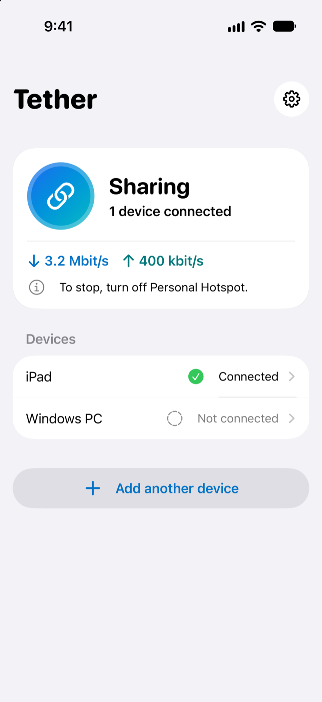
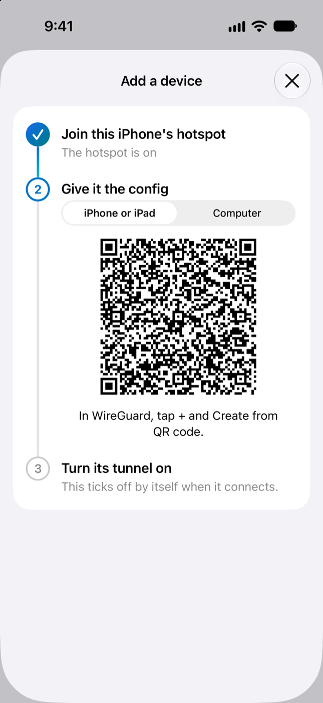
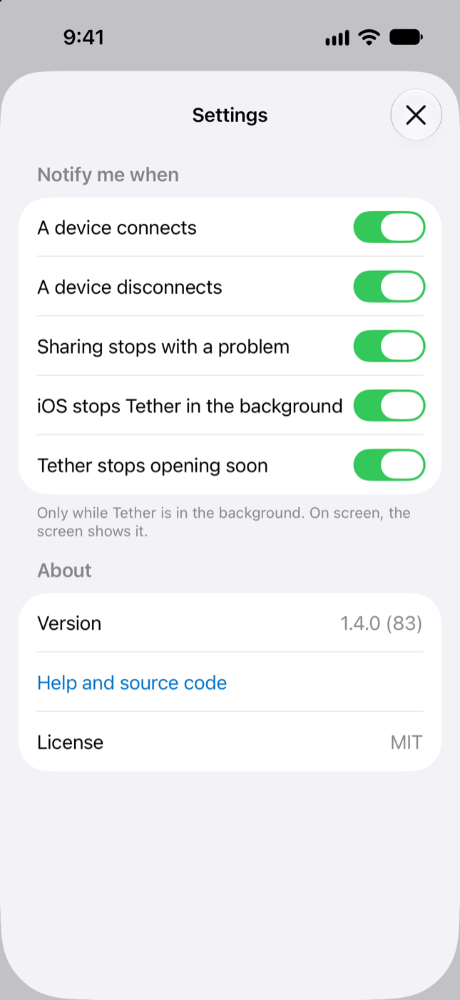

# Tether

[](https://github.com/viktor-svirsky/tether/actions/workflows/ci.yml)
[](https://github.com/viktor-svirsky/tether/releases/latest)
[](https://github.com/viktor-svirsky/tether/releases)
[](https://viktor-svirsky.github.io/tether/add/)

[](LICENSE)
[](https://viktor-svirsky.github.io/tether/)
[](https://github.com/viktor-svirsky/tether/discussions)


**Use your iPhone's data on any device, as the iPhone's own traffic instead of hotspot traffic.**

Lots of plans give the iPhone itself plenty of data, then cap, slow down or block Personal Hotspot. Tether makes every connection again on the iPhone itself, so your laptop's traffic counts as the phone's own. Windows, Mac, Linux, Android, iPad or a travel router: if it runs WireGuard, it works.


  

## What you get

- The free WireGuard app runs on Windows, macOS, Linux, Android, iPad and iPhone, and many travel routers (GL.iNet, UniFi Travel Router) have it built in. Connect a router and every device behind it is covered.
- Setup takes a minute. A phone or tablet scans a QR code, and a laptop opens a page on the hotspot and downloads its config, no camera needed.
- It's not only web pages. Video calls, games, streaming, downloads and SSH all go through.
- There's no account and nothing in the cloud. Traffic goes from your devices to your iPhone and out. Tether itself talks only to the DNS server you pick: your devices look names up through Tether at 10.7.0.1, and Tether asks Cloudflare's 1.1.1.1 unless you pick another. Settings > Devices > DNS picks another, and it applies to every device at once: Cloudflare with malware blocking, Quad9, AdGuard (blocks ads), your own Control D profile, or a server of your own. Tether asks the second server only when the first doesn't answer, so a second one under Other is a backup, and when no server answers, your devices are told so instead of waiting. With Control D, Tether asks your profile over HTTPS, so you pick the country sites see in Control D's dashboard (Redirect, on a paid plan). A device added before Tether 1.9.1 keeps the server its config names until you add it again, or set its DNS to 10.7.0.1 in WireGuard. If you narrow a device's Allowed IPs in WireGuard, keep 10.7.0.1/32 in them, or it can't look names up. Redirect works for sites and apps that look a name up first. It's free and open source (MIT).
- One shortcut turns on the hotspot and Tether together, from the Action button, a widget or Siri.

A device without WireGuard can still join the hotspot, but its traffic goes straight out as hotspot traffic and Tether doesn't help it. Tether isn't in the App Store, so you install it with SideStore or AltStore (a free Apple ID works, with a refresh every 7 days). And a carrier that looks closely can still notice, see [Good to know](#good-to-know).

## Quick start

1. [Install Tether on your iPhone](#install-tether-on-your-iphone) with SideStore or AltStore, which you set up from a Windows PC or a Mac. Or build it yourself on a Mac. Already have SideStore, AltStore or Feather? [Add Tether in one tap](https://viktor-svirsky.github.io/tether/add/) from your iPhone.
2. Turn on Personal Hotspot, open Tether and tap Add a device. It walks you through three steps.
3. On the other device, install the free WireGuard app and join the hotspot. A Windows, Mac or Linux laptop downloads its config from the address Add a device shows, usually `http://172.20.10.1`. An iPad or phone scans the code. Then turn the tunnel on ([details](#connect-a-device-with-wireguard)).

That's it. The device shows up in Tether as connected.

## Why this works

Carriers can tell when traffic comes from a device that's connected to your hotspot, and some plans block it or throttle it. Traffic that comes from the phone itself counts as phone traffic.

Tether is a small app that runs on your iPhone. Your laptop, tablet, phone or travel router still joins the hotspot, but instead of sending its traffic straight out, its WireGuard client hands it to Tether. Tether makes the connections itself, so they leave from the iPhone like its own traffic.

```
laptop, tablet, phone  ──hotspot──▶  Tether on iPhone  ──cellular──▶  internet
or router
(WireGuard client)
```

Inside, Tether runs a WireGuard server on UDP port 51820, on the hotspot address `172.20.10.1`, and also on the iPhone's IPv6 address on a carrier that gives the iPhone IPv6 only. Each device connects with its WireGuard client, and everything goes through, calls and games included. WireGuard's own code decrypts the traffic and a small TCP/IP stack inside Tether ([gVisor](https://gvisor.dev)) makes each connection again from the iPhone. UDP behaves like a full-cone NAT, so calls and games can connect directly. No VPN entitlement or network extension is needed on the iPhone.

## Install Tether on your iPhone

You need an iPhone with iOS 17 or later and a plan with Personal Hotspot. Tether isn't in the App Store, so you install it yourself: with a signing app like SideStore or AltStore (easiest), or by building it on a Mac.

### With SideStore or AltStore

SideStore and AltStore install apps on your iPhone signed with your own Apple ID. A free Apple ID is enough.

1. Install SideStore or AltStore with their own guide: [SideStore](https://docs.sidestore.io), [AltStore](https://faq.altstore.io). It needs a computer for the setup.
2. On iOS 16 or later, turn on Developer Mode: Settings > Privacy & Security > Developer Mode. The iPhone restarts and asks you to confirm. Apps signed with your own Apple ID don't open without it.
3. Add Tether's source: on your iPhone, open [the add page](https://viktor-svirsky.github.io/tether/add/) and tap Add to SideStore or Add to AltStore. Or open Sources in SideStore or AltStore, tap + and paste this:

   ```
   https://github.com/viktor-svirsky/tether/releases/latest/download/source.json
   ```

4. Find Tether in Browse and install it. New releases show up there as updates, and an update keeps your devices.
5. Open Tether, then [connect a device](#connect-a-device-with-wireguard).

A free Apple ID has limits: 3 sideloaded apps at a time (SideStore or AltStore counts as one), and each app has to be refreshed every 7 days. SideStore and AltStore do that refresh for you, see their docs for what they need.

You can also skip the source: download `Tether.ipa` from the [latest release](https://github.com/viktor-svirsky/tether/releases/latest) and open it in SideStore or AltStore.

### With Feather, a paid certificate, or another signer

Download `Tether.ipa` from the [latest release](https://github.com/viktor-svirsky/tether/releases/latest) and sign it the way you sign other apps. A paid Apple Developer account has no 3-app limit, and its builds last a year instead of 7 days.

### Check the download

Each [release](https://github.com/viktor-svirsky/tether/releases) has an unsigned `Tether.ipa`, built by GitHub Actions from the release's commit. GitHub signs a record of that build, so with the [GitHub CLI](https://cli.github.com) this shows the file you downloaded is the one built here:

```sh
gh attestation verify Tether.ipa -R viktor-svirsky/tether
```

The release notes also list its SHA-256.

A signing app usually changes the bundle ID, so a Tether installed this way is a separate app from one you built with Xcode, with its own keys. Add your devices to it again.

### Build it yourself

You need a Mac with Xcode. A free Apple ID is enough.

1. Install [XcodeGen](https://github.com/yonaskolb/XcodeGen) and Go (`brew install xcodegen go`). `xcodegen generate` builds the WireGuard part with Go first, see `scripts/build-wireguard.sh`.
2. Open `project.yml` and set `DEVELOPMENT_TEAM` to your own team ID, and `APP_BUNDLE_ID` to something unique like `com.yourname.tether`. You'll find your team ID in Xcode under Settings > Accounts.
3. Build and install:

   ```sh
   xcodegen generate
   xcodebuild build -project Tether.xcodeproj -scheme Tether \
     -destination "id=<your-iphone-udid>" -derivedDataPath .build-dd -allowProvisioningUpdates
   xcrun devicectl device install app --device <your-iphone-udid> \
     .build-dd/Build/Products/Debug-iphoneos/Tether.app
   ```

   `xcrun devicectl list devices` shows your iPhone's UDID.

   If Tether is already on the iPhone, build it with the same bundle ID, or a second Tether installs next to it with new keys and every device has to be added again. `xcrun devicectl device info apps --device <your-iphone-udid>` shows the installed one, and `APP_BUNDLE_ID=<that id>` at the end of the `xcodebuild` line uses it.
4. The first time, iOS won't open the app until you trust your developer certificate: Settings > General > VPN & Device Management > your Apple ID > Trust.
5. Open Tether. It waits for Personal Hotspot and starts by itself when the hotspot is on. You can leave it in the background.

## Connect a device with WireGuard

This works for an iPad, an iPhone, a Mac, a Windows or Linux laptop, an Android phone or a travel router. Everything goes through, calls and games too, and nothing changes on other Wi-Fi.

Tap Add a device on Tether's main screen. It shows three steps on a line that tick off by themselves: join the iPhone's hotspot on the device, give it the config, and turn its tunnel on. Pick iPhone or iPad for a QR code, or Computer for the page's address and the file. The code works while Add a device is open and for 10 minutes after it closes or you leave Tether, so a photo of it or a file kept from earlier doesn't connect later. Add a device says so under the code and the file. Opening Add a device after that shows a new code. The first time a device connects with it, or downloads it from Tether's page, the device shows up in the Devices list by itself, as Device, Device 2 and so on, and the next device gets a new code. A scanned code only counts once its tunnel is on, so steps 2 and 3 tick together then. Tap a device to see if it is connected, pause it, remove it, or tap its name at the top to rename it. Pause stops it from connecting until you resume it: its tunnel stays on, nothing gets through, and its row says Paused. A paused device counts as not connected, so Stop sharing when idle can still stop Tether. Resume lets it back in at once, with nothing to set up again.

- **iPad or iPhone:** install the free [WireGuard](https://apps.apple.com/app/id1441195209) app, then + > Create from QR code and scan the code in Add a device. Edit the tunnel and turn On-Demand on for Wi-Fi, only for your iPhone's hotspot name, then join the hotspot. The tunnel turns itself on at the hotspot and off everywhere else.
- **Windows, Mac, Linux or Android:** join the hotspot, open Add a device in Tether on the iPhone, and open `http://172.20.10.1` in a browser. Type the `http://`, since some browsers try https first and fail. Download the config there and import it into WireGuard (Import Tunnel(s) from File on a Mac or Windows, `wg-quick up` on Linux). Each download gets a key of its own, so open the page on each device. The page hands out a config only while Tether is on screen and Add a device is open or closed less than 10 minutes ago, so Add a device keeps the screen on until the device connects. On a Mac, Share the file in Add a device with AirDrop works too, but like the code, the file only works for 10 minutes after Add a device closes. A download from the page is listed at once, so it keeps working. Add a device shows the page's address as a link, with a button that copies it.
- **Travel router** (a UniFi Travel Router, a GL.iNet): add a WireGuard client in the router's VPN settings from the shared file, connect the router to the iPhone by USB or the hotspot, and turn its VPN on. Some routers send their clients' traffic from the clients' own addresses instead of their tunnel address. Tether notices that by itself and lets the router's clients through, and its traffic covers every device behind it. On other networks, turn the router's VPN off.

On a carrier that gives the iPhone IPv6 only, T-Mobile in the US among them, a Mac, an iPhone or an iPad on the hotspot takes no IPv4, so it reaches Tether at the iPhone's IPv6 address instead, like `http://[2607:fb91::1]`. A Windows PC still takes IPv4 there, so Add a device shows `http://172.20.10.1` first and the IPv6 address under it, for a Mac or a computer that can't open the first one. The iPhone only gets its IPv6 address once a device is on the hotspot, so there the code, the file and the addresses show up after the device joins. The IPv6 address comes from the carrier for each cellular session, so it can change after a restart or airplane mode. Tether keeps using the same one while the iPhone has it, also after Tether is relaunched. A device whose config points at an old one can't connect, and its row in Devices says so: remove it and add it again, and delete its old tunnel in WireGuard.

Each device has its own key. It works until you remove the device in Tether, which locks it out without touching the others. Pausing one locks it out the same way until you resume it, and keeps it in the list. Only the code for the next device stops working by itself.

## Start it from Shortcuts

Once no device has been on the hotspot for 10 minutes, iOS suspends Tether, and it has to be opened again before the hotspot comes back. Shortcuts can do that for you. Tether adds two actions to the Shortcuts app, with nothing to set up:

- **Start Tether** wakes Tether in the background, the same as opening it, but it stays off the screen. It shares as soon as a device joins Personal Hotspot in the next 10 minutes. (iOS only makes the hotspot's network while a device is on it, so that's when Tether can see it.)
- **Is Tether Sharing?** says whether Tether is sharing and how many devices are connected. It gives true or false, for an If.

You can also say "Start Tether" to Siri, find it in Spotlight, or put it on the Action button.

iOS has no automation for "Personal Hotspot turned on", so let one shortcut turn on both:

1. In Shortcuts, make a new shortcut named **Hotspot** with two actions: **Set Personal Hotspot** set to On, then **Start Tether**.
2. Run it instead of turning on the hotspot in Settings: from the Action button, a widget, or Siri ("Hotspot").
3. To have it run by itself, add an automation in Shortcuts > Automation that runs Hotspot and is set to Run Immediately. For example, when your car's Bluetooth connects, when you arrive somewhere you share from, or at a time of day.

## Good to know

- **It stops opening after 7 days** when signed with a free Apple ID. Tether says on its main screen when it has three days or less left, and in a notification once a day while it runs in the background. Refresh it in SideStore or AltStore, or build and install it again (step 3 above), before then. A paid certificate lasts longer. Your devices and settings stay.
- **Keep it running.** Tether plays silent audio so iOS doesn't suspend it in the background. It mixes with other audio, so your music keeps playing, and it picks up again after a call, Siri, or an audio reset. During an answered call iOS pauses Tether, and sharing comes back when the call ends (some carriers carry no data during a call anyway). With no device on the hotspot for 10 minutes it stops, to save battery, and iOS suspends Tether. Open it again, or run Start Tether, before you turn the hotspot back on, and after a restart. With the hotspot on and no device connected to Tether, it keeps running. To save battery then too, set Settings > Stop sharing when idle to 10 minutes, 30 minutes or an hour (it's off at first). Open Tether, or run Start Tether, to share again.
- **Notifications** say when a device connects or disconnects, by its name, when sharing stops with a problem while devices were connected, when sharing stops while idle, when iOS stops Tether in the background while it shares, and when Tether stops opening soon. The gear at the top of the main screen opens Settings, with a switch for each. They come only while Tether is in the background, since the screen shows the same. Tether asks for permission on screen the first time something happens that it would tell, like a device connecting as you add it. Or tap Allow notifications in Settings first. A device counts as gone a few minutes after it leaves, and one device posts at most once in 5 minutes, so a laptop that sleeps for a moment stays quiet.
- **A device can't connect?** Check Settings > Privacy & Security > Local Network: Tether has to be on there, or iOS blocks its replies to your devices. The first time you open Tether, it says what it needs this for. When iOS asks, tap Allow. When it's off, Tether's main screen and Add a device say so, with the way to turn it on. On a carrier that gives the iPhone IPv6 only (T-Mobile US, Metro and others on its network), a Mac reaches Tether only at the iPhone's IPv6 address, so it needs IPv6 on for the hotspot, and Add a device says so: if the Mac's address doesn't open, turn on IPv6 for the Mac's Wi-Fi. That's System Settings > Network > the hotspot > Details > TCP/IP > Configure IPv6 > Automatically. If you reinstalled Tether with another certificate, it made new keys, so add the device again with a new code. When a device keeps trying with a config that no longer works (its code expired before it first connected, you removed it, or Tether made new keys), the main screen says so, and so does the page at `http://172.20.10.1` on that device: delete its tunnel in WireGuard and add it again.
- **It only listens on the hotspot**, never on other Wi-Fi networks. WireGuard only lets in devices you added.
- **Devices reach what the iPhone reaches**, private networks included, but not the iPhone itself: apps that listen on the iPhone stay closed to them, apart from Tether's own page. With a VPN on the iPhone, your devices use it too, so its networks are open to them and to everyone behind a travel router you added.
- **The main screen** shows whether Tether is sharing, Add a device, your devices with Connected, Not connected or Paused and what each used this month, and the current download and upload speed. Tap a device for its screen: its status, when it last connected while it isn't or the address it connects from while it is, Pause, and the data it used through Tether this month (down and up) and last month, counted from the 1st in the iPhone's time zone and kept across relaunches. iOS Settings > Cellular counts a few percent more, since it adds the iPhone's own headers. A device can have a data limit per month (5, 10, 20, 50 GB or an amount you type): its screen shows a meter, Tether tells you at 90%, and at the limit it pauses the device until the 1st. Resume it to let it go over until then. A travel router's limit covers every device behind it. The gear opens Settings: when to stop sharing while idle, the DNS server Tether asks for your devices, the notification switches, Share the log, the version, and when this build stops opening. To stop sharing, turn off Personal Hotspot.
- **The traffic leaves as your iPhone's.** If your iPhone runs a VPN, shared traffic goes through that VPN too.
- **Your carrier can still notice.** Tether hides where the traffic comes from, not what it is. A Mac's software updates or an iPad's apps still look like a Mac or an iPad to a carrier that looks closely. Many carrier contracts don't allow tethering workarounds, and a carrier can slow down or close a line that breaks them. Check yours. Using Tether is your call and your risk.
- **Not for the App Store.** Apple doesn't allow the silent-audio trick, so you sign and install Tether yourself.
- **Questions and ideas** go in [Discussions](https://github.com/viktor-svirsky/tether/discussions): how to set something up, whether your carrier works, a feature you'd like. Something broken goes in a [bug report](https://github.com/viktor-svirsky/tether/issues/new?template=bug.yml). Attach the log to it: Settings > Share the log saves a text file of what Tether did lately, with your keys and full addresses left out.

## For developers

```
Sources/WireGuardServer.swift  runs the WireGuard server; WireGuardSetup.swift has the keys and configs
WireGuard/                   the WireGuard server in Go: wireguard-go plus a gVisor TCP/IP stack
scripts/build-wireguard.sh   builds WireGuard/ into TetherWG.xcframework (xcodegen runs it)
scripts/build-ipa.sh         builds the unsigned Tether.ipa; make_source.py writes source.json for it
scripts/next-version.sh      picks the next release version from the last tag
scripts/which-release.sh     says whether main is at a release branch, which releases it by itself
scripts/release-notes.sh     lists the issues a release fixes, for its notes
Sources/HotspotSession.swift finds the hotspot, starts the server, samples traffic (tested on the Mac)
Sources/Model.swift          runs the session on timers and feeds the screens
Sources/MainView.swift       the main screen; AddDeviceSheet.swift has the steps and the QR code, DevicesView.swift the device screen
Sources/DeviceStatus.swift   what a device's row and screen say: Connected, Not connected or Paused (tested on the Mac)
Sources/MonthlyUsage.swift   each device's data this month and last, and when it last connected, kept across relaunches (tested on the Mac)
Sources/ConfigPage.swift     the page on the hotspot that hands out the next device's config; ConfigPageServer.swift serves it
Sources/Notices.swift        what to tell in a notification and when (tested on the Mac), and SettingsView.swift the Settings sheet
Sources/DebugLog.swift       the log Settings shares, with the Go server's lines, and LogRedaction.swift what it leaves out (tested on the Mac)
Sources/KeepAlive.swift      silent audio to stay alive in the background
Sources/Shortcuts.swift      the Start Tether and Is Tether Sharing? actions for Shortcuts and Siri
Sources/DemoMode.swift       the UI tests' demo states, run through the real session (Debug builds only)
Sources/Fakes.swift          the stand-in server, page and sound the unit tests and demos share (Debug builds only)
Tests/                       unit tests, run on the Mac
UITests/                     UI tests for every screen, run on the iOS Simulator
scripts/screenshots.sh       makes the three screenshots above, on an iPhone simulator
docs/index.html              the landing page at viktor-svirsky.github.io/tether, served by GitHub Pages from docs/
docs/add/index.html          the one-tap "Add to SideStore/AltStore" page, served by GitHub Pages from docs/
```

The file map at the top of Model.swift lists every source file.

Run the unit tests with `swift test` (after `scripts/build-wireguard.sh` or `xcodegen generate`, since they link the WireGuard server), and the WireGuard server's own with `go -C WireGuard test ./...`. They start the real server on your Mac and talk to it over loopback, so you don't need a device. [TESTING.md](TESTING.md) covers the simulator UI tests and the checks by hand.

Features go to a release branch for the next version (`release-1.6`), not to main. To release it, move main to that branch: once CI passes on main, the Release workflow publishes 1.6.0 by itself. `scripts/which-release.sh` checks that main is at a release branch whose version isn't out yet, and that the release branch got there before main did, so other changes on main (refactors, tests, CI) release nothing. Take a fix from main into a release branch with a merge commit (`git merge --no-ff main`), never a fast-forward: a release branch fast-forwarded to main has nothing of its own and doesn't release. Push the release branch first, then main in a second push: one push of both leaves no way to tell which came first, so it releases nothing. For a patch, open Actions > Release > Run workflow on main and pick what goes up: patch, minor or major. `scripts/next-version.sh` works out the version from the last tag, `scripts/build-ipa.sh` builds `Tether.ipa`, `make_source.py` writes `source.json`, and the workflow publishes both as a GitHub release, which creates the tag. The notes come from `scripts/release-notes.sh`: each issue a commit since the last release says it fixes (`Fixes #N`), if the issue is closed, the commit wasn't reverted, and it isn't labelled tests, ci, dependencies or documentation. So every change people can see needs a `Fixes #N` line, and work taken out of a release reopens its issue. `python3 scripts/test_make_source.py`, `scripts/test-next-version.sh`, `scripts/test-which-release.sh` and `scripts/test-release-notes.sh` test the scripts.

## License

MIT, see [LICENSE](LICENSE).

The WireGuard server is built from [wireguard-go](https://git.zx2c4.com/wireguard-go) (MIT), [gVisor](https://gvisor.dev) (Apache 2.0), [google/btree](https://github.com/google/btree) (Apache 2.0) and Go's `golang.org/x` packages (BSD). `WireGuard/go.mod` pins their versions, and Go downloads each one with its license. A built Tether app contains their code, so if you give a build to someone, include their licenses with it. `scripts/build-ipa.sh` collects them into `LICENSES.txt`, which each release has next to `Tether.ipa` and inside the app.
