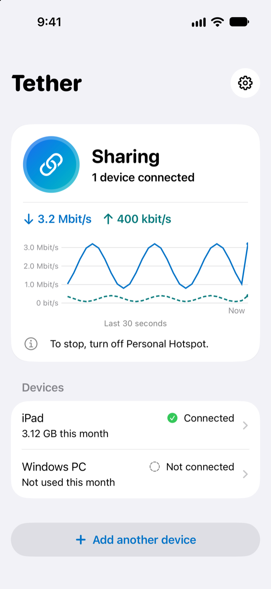
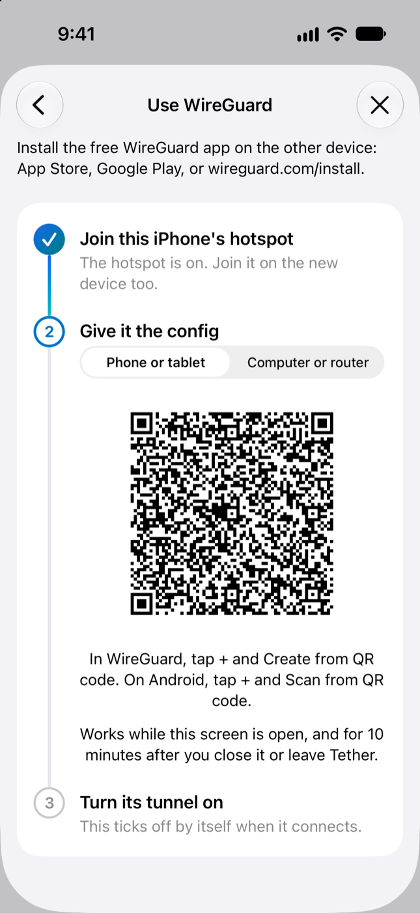
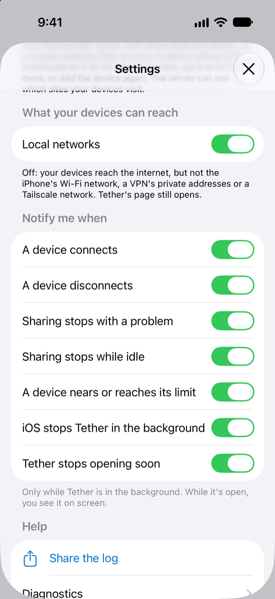

# Tether

[](https://github.com/viktor-svirsky/tether/actions/workflows/ci.yml)
[](https://codecov.io/gh/viktor-svirsky/tether)
[](https://coderabbit.ai)
[](https://github.com/viktor-svirsky/tether/releases/latest)
[](https://viktor-svirsky.github.io/tether/add/)

[](LICENSE)
[](https://viktor-svirsky.github.io/tether/)


**Use your iPhone's data on any device, as the iPhone's own traffic instead of hotspot traffic.**

Lots of plans give the iPhone plenty of data, then cap, slow down or block Personal Hotspot. Tether makes every connection again on the iPhone itself, so your laptop's traffic counts as the phone's own. Windows, Mac, Linux, Android, iPad or a travel router: if it runs WireGuard, it works. A TV or a console with a proxy setting can use Tether's proxy instead, for its browser and most apps. Games, calls and apps that skip the proxy still count as hotspot data.


  

## How it works

```
laptop, tablet, phone  ──hotspot──▶  Tether on iPhone  ──cellular──▶  internet
or router (WireGuard)
```

Your device still joins the hotspot, but its WireGuard client hands the traffic to Tether, and Tether sends it out from the iPhone. Calls, games, streaming and SSH all work. There's no account and nothing in the cloud.

<a name="install-tether-on-your-iphone"></a>

## Install

You need an iPhone with iOS 17 or later. Tether isn't in the App Store, so you install it with SideStore or AltStore. A free Apple ID works.

1. Set up [SideStore](https://docs.sidestore.io) or [AltStore](https://faq.altstore.io). It needs a computer once.
2. Turn on Settings > Privacy & Security > Developer Mode.
3. On the iPhone, open [the add page](https://viktor-svirsky.github.io/tether/add/) and tap Add to SideStore or Add to AltStore (Feather works there too), or add this source by hand:
   ```
   https://github.com/viktor-svirsky/tether/releases/latest/download/source.json
   ```
4. Install Tether from Browse.

With a free Apple ID, apps stop opening after 7 days unless SideStore or AltStore refreshes them. Tether warns you 3 days before. Close Tether before you update it in SideStore, or the install can hang.

Other ways to install (Feather, a paid certificate, building it on a Mac) are in the [guide](docs/GUIDE.md#install).

## Connect a device

1. Turn on Personal Hotspot, open Tether and tap **Add a device**.
2. On the other device, install the free WireGuard app and join the hotspot.
3. Give it the config. An iPad or phone scans the QR code. A laptop opens the address Add a device shows, usually `http://172.20.10.1`, and downloads the file.
4. Turn the tunnel on. The device shows up in Tether as Connected.

The code works while Add a device is open and for 10 minutes after. No WireGuard app on the device, but a proxy setting? Pick No, use the proxy in Add a device, and set the server and port it shows as the device's proxy. Travel routers, IPv6-only carriers and per-device settings are in the [guide](docs/GUIDE.md#connect-a-device).

## Good to know

- **Keep Tether running.** It plays silent audio so iOS doesn't suspend it. After 10 minutes with no device on the hotspot it stops to save battery, so open it again (or run the Start Tether shortcut) before you turn the hotspot back on.
- **A device can't connect?** Check that Tether is allowed in Settings > Privacy & Security > Local Network. More fixes are in the [guide](docs/GUIDE.md#troubleshooting).
- **Your carrier can still notice.** Tether hides where traffic comes from, not what it is. A VPN on the iPhone that carries all its traffic hides what it is too, but not that you use a VPN or how much data. See the [guide](docs/GUIDE.md#good-to-know). Check your contract. Using Tether is your call and your risk.
- **Questions** go in [Discussions](https://github.com/viktor-svirsky/tether/discussions). Bugs go in a [bug report](https://github.com/viktor-svirsky/tether/issues/new?template=bug.yml), with the log from Settings > Share the log.

The [guide](docs/GUIDE.md) has everything else: DNS, data limits, notifications, Shortcuts and how Tether works inside.

## For developers

Run `swift test` (after `scripts/build-wireguard.sh` or `xcodegen generate`, since the tests link the WireGuard server) and `go -C WireGuard test ./...`. Both run on a Mac, no device needed. The file map is at the top of `Sources/Model.swift`, [TESTING.md](TESTING.md) covers the UI tests, and [RELEASING.md](RELEASING.md) covers releases.

## License

MIT, see [LICENSE](LICENSE). The WireGuard server is built from wireguard-go, gVisor and other open source code. Each release has their licenses in `LICENSES.txt`, see the [guide](docs/GUIDE.md#license).
